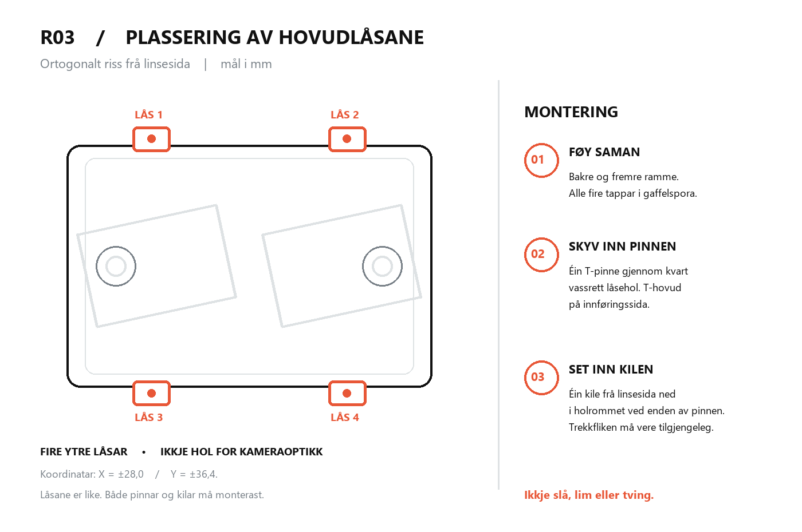

# R03 — reparasjon av laus stereoramme

**Dette settet er laga for dei to store R03-delane som alt er 3D-printa. Ikkje print dei store delane om att.**

## Kvifor alt heng laust

I R03-CAD er den bakre batteriramma (`01_bank_cradle`) og den fremre dobbelkameraramma (`02_multigrip_carrier`) to separate plastdelar. Dei er **ikkje** sjølvlåsande. Dei må haldast saman med **fire horisontale T-pinnar og fire loddrette låsekilar** i dei fire ytre rammekoplingane. Utan desse er det naturleg at heile oppsettet vippar og sklir. Dei to kamerakorta krev dessutan eigne bakhaldarar og linsebøylar for endeleg montering.

## Kva du skal printe

1. **Start her:** `3MF/R03-00-FIT-TEST-TRY-FIRST.3mf`. Dette inneheld éin pinne av kvar storleik + éin kile. Heile printet er lite. Skrivaren treng ikkje dei to store kroppane på plata.
2. Test pinnane direkte i EITT av dei fire ytre gjennomgåande låsehola med dei to store delane på plass. Pinnane har synlege hakk på T-hovudet: **A = eitt hakk**, **B = to hakk**, **C = tre hakk**. Start med B. Vel A om B bind, eller C om B går lett med tydeleg slark. Bruk berre fingrane, aldri hammar eller tang.
3. Print settet som passar: `R03-01-FOUR-FRAME-LOCKS-A_EASY.3mf`, `...-B_SNUG.3mf` eller `...-C_FIRM.3mf`. Kvart sett inneheld fire like pinnar og fire kilar.
4. For resten av kameraet, om du berre har printa dei to store delane: `3MF/R03-02-REMAINING-SMALL-PARTS.3mf`. Dette inneheld venstre/høgre bakhaldar for ESP32-CAM-MB, venstre/høgre linsebøyle, åtte forsiktige A-pinnar og åtte kilar. Vurder støtter i sliceren spesielt under utspringa på linsebøylane.

**Merk:** Desse filene er *uslica 3MF-modellplater*. Opne i Bambu Studio, vel faktisk P1S, 0,4 mm dyse, korrekt plate og filament, og slic der. Til dei små låsane: ca. 0,12–0,16 mm laghøgd, minst fire vegglinjer og høgt/tett fyll (gjerne 100 %). Delane ligg flatt på printplata; pinnen skal ikkje reisast på høgkant. Støtte er normalt ikkje naudsynt på låsane. Kontroller at alle små delar har kontakt med printplata før sending.

## Monter dei to store delane

1. **Reins:** Fjern eventuell støtteplast, laus tråd og «elephant foot» frå dei fire ytre gaffelspora og frå dei motståande tappane. Reins særleg dei tversgåande rektangulære hola. Ikkje skjer bort materiale på måfå.
2. **Legg saman:** Plasser bakre batteriramme mot kameraberaren. Pass på at alle **fire ytre tappar** går inn i dei tilhøyrande gaffelspora. Dei to rammene skal liggje plant mot kvarandre rundt heile omkrinsen.
3. **Tverrpinnar:** Set ein vald T-pinne gjennom kvar av dei fire horisontale kanalane på ytterrama. Det breie T-hovudet blir ståande på innføringssida; det vesle holrommet i enden skal vere synleg på motsett side.
4. **Låsekilar:** Før ein låsekile ned gjennom holrommet nær enden av kvar pinne frå linsesida. Den breie trekkfliken blir verande tilgjengeleg. Kilen sikrar pinnen mot å gli ut.
5. **Prøv:** Hald i dei to store delane og prøv å vrikke dei forsiktig. Ingen pinne skal gli ut, og gaffelen skal ikkje sprekke. Om ramma framleis klaprar, kontroller at alle fire tappane er heilt på plass. Ein smal, ikkje-leiande foliestripe (om lag 0,1–0,2 mm) mellom flatene på ein laus gaffeltapp kan ta opp restslark, **men dekk aldri hol eller elektronikk**.
6. **Fullfør seinare:** Monter kamera/ESP32-MB og powerbank etter den originale `../README.md` berre når dei faktiske korta og leidningane er målte. Linsebøylane må ikkje trykkje ned på optikk eller flekskabel. Batteriet skal ikkje vere i spenn, eller pressast mot skarpe plastkantar.

## Geometri og avgrensingar

| Pinne | Hakk | Breidd | Høgd | Teoretisk rom i låsekanalen |
|---|---:|---:|---:|---|
| A (lett) | 1 | 6,00 mm | 4,30 mm | 0,50 mm breidd; 0,20 mm høgd |
| B (snug) | 2 | 6,16 mm | 4,41 mm | 0,34 mm breidd; 0,09 mm høgd |
| C (fast) | 3 | 6,28 mm | 4,47 mm | 0,22 mm breidd; 0,03 mm høgd |

Original låsekanal: 6,50 × 4,50 mm. Låsekilen har **same profil som original R03**. Dei store delane er ikkje modifiserte. Passforma er kontrollert mot parametrisk CAD og STL-kvalitet, men **ikkje fysisk testa på dine PLA-print**. Start difor med prøveplata.

`source/build_repair.py` kan regenerere STEP, STL, 3MF og QA-kontrollar. `QA.json` viser presise nominelle mål og SHA-256 for alle genererte filer.

**Stopp og ikkje tving om ein pinne må hamrast inn, ein kile pressar på sensor/PCB, ramma står skeivt, eller du ser sprekker.** Då er det ei faktisk toleranse- eller monteringsfeil som krev måling.

## Teikning: Dei fire låsepunkta

