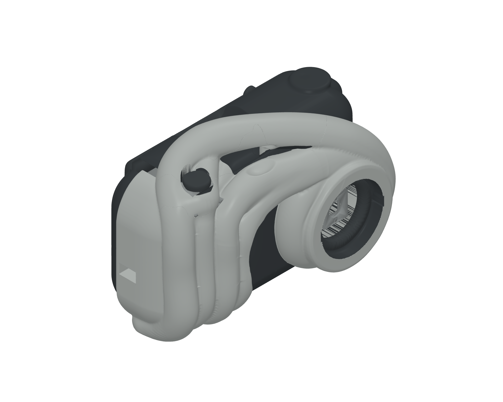

# A1 - mekanisk assembly R01



Den valde Tripo-forma har fått eit faktisk mekanisk delsett: eit maskinert ytterskal, krummt baklokk med styretunge, fire printa kvartomdreiingslåsar, uttakbar CAM/MB-haldar med framført kamerasete, kameraklemme, bajonettring og ein fanga utløysar med kassett. Produktet har 11 printdelar. Eit låseverktøy og ei testhylse kjem i tillegg.

**Status: digitalt kontrollert mekanisk prototype. Fysisk passform og kamerafunksjon er ikkje frigjevne.** Brukaren har valt ESP32-CAM + MB. Nøyaktig kortvariant, MB-mål, kamerafleks, kontaktar og brytar er ikkje målte.

[Monteringssteg, seks sider](review/A1-Montering-R01.pdf) · [Eksplodert vising](review/A1-exploded.png) · [Samla assembly i 3MF](review/A1-assembled.3mf) · [Samla GLB-vising](review/A1-assembled.glb)

## Utskrift

Print først `print/test_lock_socket.3mf` og éin lås. Kontroller at låsen kan førast inn, dreiast 90 gradar og løysast utan skade.

Dei 13 individuelle 3MF-filene inneheld separate printobjekt. `print/A1-plate-01.3mf` og `print/A1-plate-02.3mf` er plasserte på 256 mm plater. `review/A1-assembled.3mf` viser delane i montert posisjon og skal ikkje printast som eitt objekt.

Vel faktisk Bambu Lab P1S, dyse og filament i Bambu Studio. Den generiske testprofilen brukar PLA, 0,4 mm dyse, 0,20 mm lag, tre veggar, 15 % gyroid og automatisk støtte. Støtte og faktisk P1S-profil må kontrollerast før maskinkode. Ingen maskinkode følgjer leveransen.

Breidda 140 mm er ein vald formstorleik. Det er ikkje eit mål henta frå fysisk kamerautstyr.

## Geometri og kontroll

Ytterdelane kjem frå den detaljerte, lukka Tripo-meshen i `../mesh/03-quick-capped.glb`. Funksjonsopningar og mekaniske grensesnitt er boolsk maskinerte i denne forma. Ytterforma er ikkje bytt ut med den tidlegare CAD-rekonstruksjonen. Mikroskopiske lukka restkomponentar frå boolske snitt er dokumenterte og fjerna innan ei samla grense på 0,01 mm³ per eksport.

Begge printplatene er slicer-verifiserte utan åtvaringar. Alle 13 objekt finst i maskinbanene, med modell- og støttemateriale innanfor 256 mm-plata. Den generiske testen estimerer 298,58 g totalt og 22 t 35 min + 53 min; faktisk P1S-tid er ikkje verifisert.

Den uavhengige kontrollen testar lukka topologi, positivt volum, samanhengande delar, 55 delpar og ni prøvde monteringsforløp. Separate 3MF-filer brukar 17 signifikante siffer og er kontrollerte ved innlesing. Målretta vegg- og synslinjekontroll finst i `verification/targeted-walls-and-optics.json`. Desse prøvene er ikkje ei global veggtjukkleiks- eller optikkgodkjenning.

## CAD-format

`A1_Analytic_Mechanism.step` samlar dei analytiske produktdelane, inkludert stemmet til utløysaren. Verktøy og testhylse er utelatne frå denne assembly-fila og finst som eigne delar. Individuelle STEP-filer ligg i `parts/`.

Dei detaljerte skaloverflatene og den native knappetoppen er mesh. Dei er med i den komplette 3MF-/GLB-assemblyen. STEP-fila er ikkje ei nøyaktig full-shell BRep-utgåve av desse meshdelane.

CAD-kjelde og målgrunnlag ligg i `cad/`. Med avhengigheitene i `cad/requirements.txt` kan geometrien byggjast frå A1-meshen:

```bash
python cad/cache_source.py
python cad/build_assembly.py
python cad/verify_assembly.py
python cad/export_review.py
python cad/verify_walls.py
```

## Attståande fysisk grunnlag

- Mål CAM/MB-stakken, kontaktvolum, linseplassering og kamerafleks før endeleg tilpassing. 28 × 48 × 22 mm stakkplass og det framførte kamerasetet er nominelle føresetnader.
- Setet for ein 6 × 6 mm utløysarbrytar er nominelt. Eigd brytar, slag, retur og elektrisk funksjon er ikkje stadfesta.
- MB brukar normalt Micro-USB til straum og seriell programmering. Straumforsyning, USB-C-lading og USB-biletoverføring er ikkje løyste av desse plastdelane.
- Ei fri frontopning på 30 mm er ikkje dokumentasjon på ei 30 mm optisk linse.
- Prøveprint, faktisk montering, optikk, varme og bruk er ikkje testa fysisk.

Sjå `bill-of-materials.json`, `release-info.json` og rapportane i `verification/` for status og avgrensingar.
