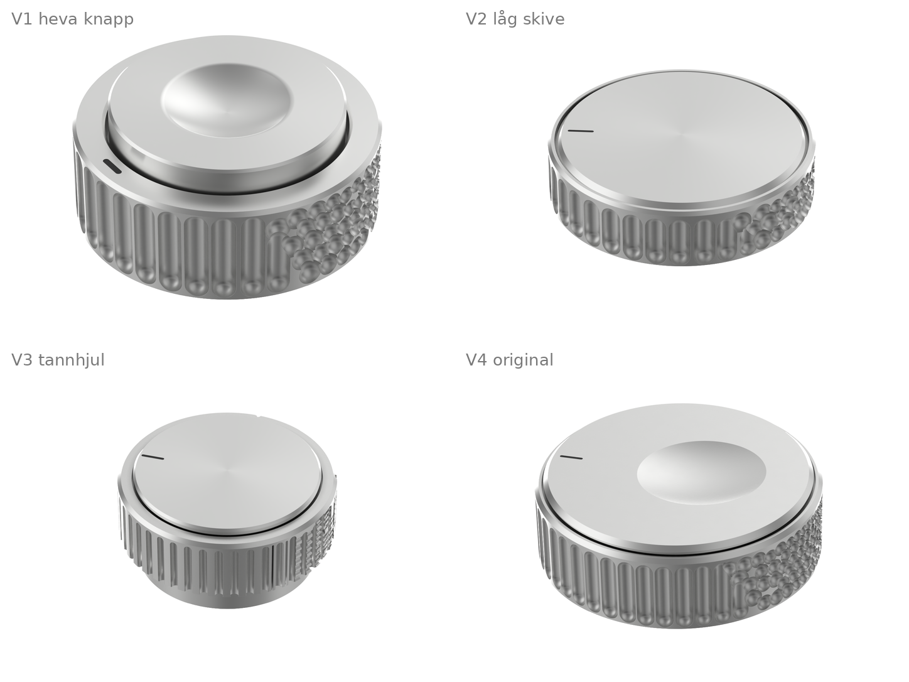

# A17 entropihjul R01

Fire variantar av toppvelgaren til A17-kameraet, modellerte som ekte B-rep (build123d / OpenCascade) og rendra i same vinkel som konseptbileta. Alle er Ø24 mm og har same grensesnitt: D-hol Ø6 med flate 4,5 for EC11-aksel, 5 mm djupt frå undersida (4,5 mm på V2).



## Entropiregelen

Riflinga går frå orden til uorden rundt omkrinsen. Entropien e(θ, z) stig frå 0 like til høgre for fronten til 1 over 70 til 90 grader, og toppen løyser seg opp først. Der e er låg, står heile riller. Der e stig, blir rillene brotne opp og går over i groper som blir mindre og fleire di høgare e er. Bak, ved 120 grader, ligg ein saum der ordenen byrjar på nytt. Tennene på V3 følgjer same regel, men går via periodedobling (tanna blir delt i to tynne tenner) til hakka tenner.

## Variantane

| | V1 heva knapp | V2 låg skive | V3 tannhjul | V4 original |
|---|---|---|---|---|
| Total høgd | 10,41 | 6,15 | 11,73 med fotring | 7,70 |
| Ringhøgd | 8,56 | 5,87 | 7,34 | 7,00 |
| Lokk over ring | 1,85 | 0,28 | 0,79 | 0,70 |
| Lokk | Ø18,4, sentrert skål Ø10 × 1,2 | Ø22,56, flatt | Ø20,54, flatt | Ø22,5, forskoven elliptisk skål 10,7 × 9,8 × 0,75 |
| Rifling | 36-delt: 17 riller, 268 groper | 36-delt: 18 riller, 291 groper | 45 tenner, deling, 234 hakk | 48-delt: 23 riller, 567 groper |
| Indeks | pille i ringtoppen | strek på lokket | strek på lokket | strek på lokket |
| Ringtopp | spunnen | sandblåst | sandblåst | sandblåst |
| Lokk, topp | spunne | spunne | spunne | sandblåst |
| Lokk, kant | børsta | polert | polert | polert |
| Ekstra | | | fotring Ø19,9 × 3,3 | |
| Masse i aluminium | 10,5 g | 6,7 g | 9,8 g | 8,4 g |

Mål i mm. Riflinga er sandblåst, fasane polerte. Indeksen er eit spor fylt med svart lakk.

## Filer

| Mappe | Innhald |
| --- | --- |
| `cad/V1` til `cad/V4` | `.step.zip`: STEP-samanstilling med namngjevne delar (`ring_riflet`, `lokk`, `indeks_lakk`, `fotring` på V3), pakka fordi STEP-filene er 14 til 149 MB. `.stl`: alle delane i éi fil, toleranse 0,01 mm. `.glb`: for vising. |
| `rendringar/` | Ei rendring per variant i konseptbiletets vinkel, kvit bakgrunn utan skugge. `A17-entropihjul-samanlikning.png` har konseptet til venstre og CAD-rendringa til høgre. |
| `referansar/` | Dei fire konseptbileta. |
| `verktoy/` | Generator, parametrar, kamera, lyskart og rendring. |

## Kontroll

Alle solidane er gyldige og lukka (BRepCheck), éin solid per del. Kameraet er tilpassa kvart konseptbilete med silhuett og kantmål, og lyskartet er kalibrert mot konseptbileta.

## Køyre på nytt

Krev Python 3 med build123d 0.13, numpy, scipy, opencv-python og Pillow, og `bpy` (Blender som Python-modul) for rendringa. Køyr frå `verktoy/`:

```
mkdir -p out
python3 gen.py v1.json out/f1                                # ring, lokk og lakk som BREP
python3 export_cad.py out/f1 A17-entropihjul-V1-R01 out/V1    # STEP, STL og GLB
python3 export_render.py out/f1 0.006                        # mesh med finishgrupper
python3 render.py -- out/f1_render.npz cam_v1.json out/v1.png final.json
python3 make_sheets.py out                                   # når out/v1.png til out/v4.png finst
```

Alle parametrane ligg i `defaults.json`, og `v1.json` til `v4.json` overstyrer dei. Ein tredje parameter til `gen.py` overstyrer enkeltverdiar, til dømes `'{"N": 40}'`. `camfit.py` og `dimfit.py` tilpassar kameraet til eit konseptbilete, `env_make.py` og `fit_env3.py` kalibrerer lyskartet.
