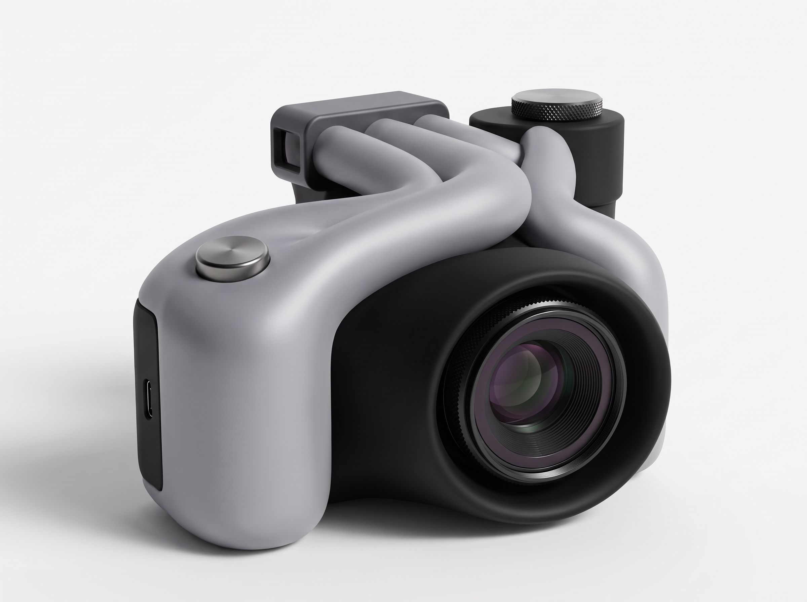
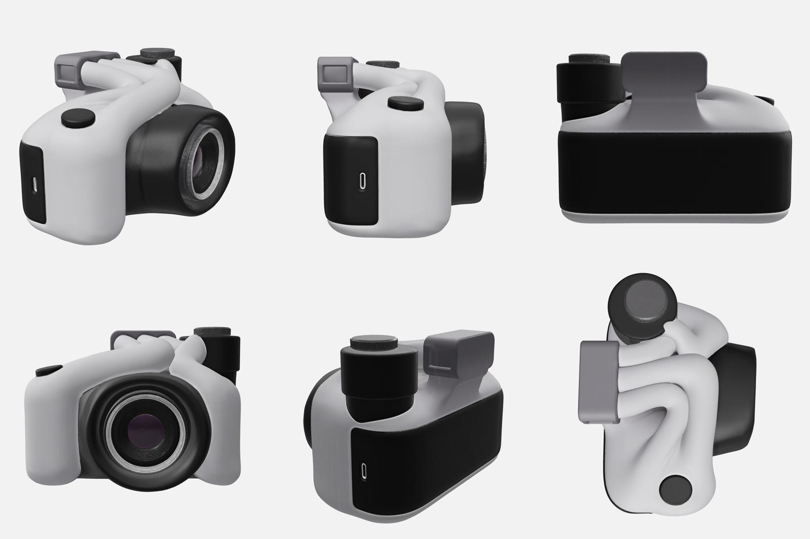

# A3 – Entropi

**Konseptord:** Entropi – det som skjer når lys møter eit svart hol.
Handhalde kamera for FormNerd, AHO haust 2026. Bilete og 3D er laga med Tripo-API-et frå den måla skissa i `00-input/`.



## Formidé

Eit kamera er alt eit mørkt kammer som et lys. Den matt svarte kjernen er det svarte holet, og dei lyse, mjuke tubane er lyset. Tubane byrjar roleg ved grepet, vrir seg over toppen og forsvinn ned i den svarte trakta rundt linsa, som er hendingshorisonten.

## Mapper

| Mappe | Innhald |
| --- | --- |
| `00-input/` | Skissa og dei to tidlegare tube-renderane som vart brukte som referanse |
| `01-variantar/` | Seks bildevariantar, kontaktark (`kontaktark.jpg`) og juryresultat (`jury.json`). Kvar Tripo-oppgåve ligg i `oppgaver/` som `*.payload.json` (det som vart sendt) og `*.tripo.json` (svar, task-ID og kreditt). |
| `02-hero/` | `hero-cmf.png`: endeleg CMF-bilete. `3d-referanse.png`: same design i jamt lys, brukt som input til 3D. |
| `03-3d/` | 3D-modellen (sjå under) |
| `04-kontroll/` | Kontrollrenderar (tekstur og leire, seks vinklar), djupnekart over linsa i mm, og `verifisering.json` |
| `verktoy/` | Skripta som laga alt i mappa |

## Prosess

1. **Kalibrering** med banana_pro rett frå skissa (`0-kalibrering.png`).
2. **Seks vinklar** på konseptet med Tripo image-to-image, éin generering kvar:

   | Variant | Idé | Modell | Konsept | Design | 3D | Sum |
   | --- | --- | --- | --- | --- | --- | --- |
   | c gravitasjonsbrønn | Fronten søkk inn som ei trakt mot linsa | banana_pro | 6,5 | 7,5 | 7 | **21** |
   | d fusjon med ref | Skissa slått saman med dei tidlegare tube-renderane | banana_pro | 5,5 | 8,5 | 7 | **21** |
   | f lysgradient | Tubane går frå kvitt ved grepet til svart ved linsa | chat_image_2.5_flare | 7,5 | 7 | 6 | 20,5 |
   | a skisse-hero | Tru mot skissa, ekte linse | banana_pro | 4,5 | 8 | 8 | 20,5 |
   | b spaghettifisering | Ordna tubar ved grepet, kaos over toppen, sogne inn i linsa | banana_pro | 6 | 4,5 | 4 | 14,5 |
   | 0 kalibrering | LED-ring rundt eit svart tomrom | banana_pro | 6 | 3,5 | 3 | 12,5 |

   e (seedream_v5) vart avvist av API-et (for lang prompt, deretter grense for generering) og har ikkje noko bilete.
3. **Jury.** Tre uavhengige domarar gav poeng: konsept og semiotikk, industridesign og gjennomføring, og eigna for 3D. Kriteria kjem frå *02 Semiotikk* og *03 Formanalyse – rammeverk*. c og d delte fyrsteplassen, og c gjekk vidare.
4. **Finpuss.** Domarane sine merknader vart lagde inn i ein hero-render og ein rein 3D-referanse (`02-hero/`).
5. **3D.** Tripo image-to-model v3.1 med detaljert geometri og PBR-tekstur (60 kreditt).
6. **Kontroll.** Eit panel med tre linser såg på 3D-modellen: kor tru han er mot biletet, om han kan skrivast ut, og om han ber konseptet. Ein skeptikar prøvde deretter å motbevise kvart viktig funn. Resultatet ligg i `04-kontroll/verifisering.json`.

## 3D-filer

| Fil | Bruk |
| --- | --- |
| `03-3d/a3-entropi-pbr.glb` | Full modell, om lag 2 mill. trekantar, 4K PBR-teksturar (62 MB). Metallic er sett til 0, sjå kjende avvik. |
| `03-3d/a3-entropi-web.glb` | Lett versjon for nett og førehandsvising, om lag 300 000 trekantar, 2K WebP (7 MB) |
| `03-3d/a3-entropi-print-120mm.stl` | Utskriftsklar, Z opp, 120 mm brei, vasstett og manifold (400 000 trekantar) |
| `03-3d/tripo-forehandsvising.webp` | Tripo sin eigen render |
| `03-3d/mesh-qa.json` | Topologi og SHA256 for rå-GLB-en |



## Mål og utskrift (Bambu Lab P1S)

- Ved 120 mm breidd blir kroppen 120 × 90 × 85 mm (breidd × djupn med linse × høgd), og volumet 499 cm³.
- STL-en er vasstett med 0 opne og 0 ikkje-manifolde kantar. Største avvik frå rå-GLB-en etter desimering og reparasjon er 0,115 mm.
- **Linse:** linseløpet er Ø ≈ 40 mm og trakta Ø ≈ 53 mm, så kravet om minst 30 mm er oppfylt av objektivet. Sjølve glaset er berre Ø ≈ 18 mm og ligg om lag 10 mm inne. Skal kravet lesast som glaset, må glaset gjerast større i CAD (sjå under).
- **Retning:** skriv ut med linsa opp, ståande på baksida av søkaren. Bruk tre-støtte berre frå plata og 5–8 mm brim. Då hamnar inga støtte i sporet rundt linseløpet eller i tunnelane mellom tubane.
- Bruk 3–4 veggar og 10–15 % infill. Modellen treng ikkje holast ut eller delast.
- Sporet rundt linseløpet (om lag 2,5 mm breitt og 16,7 mm djupt) kan ikkje slipast. Bruk tynne sprøytestrøk utan sparkelgrunning.

## Kjende avvik (stadfesta av skeptikaren)

| Avvik | Alvor | Status |
| --- | --- | --- |
| Det svarte holet er ikkje eit ekte tomrom. Linseløpet fyller trakta, så i einfarga måling les midten lyst. | Viktig | Designval, sjå CAD-forslag |
| Skjult side (ved hjulet) er ein spegling av grepsida, med ein ekstra USB-C og eit ekstra panel | Viktig | Fyll i CAD |
| Søkarvindauget vender ut til sidene på begge sider, og baksida er blank | Viktig | Flytt til baksida i CAD |
| Blokkene står rett opp, og det finst ingen gradient frå orden til uorden | Viktig | Sjå CAD-forslag |
| Glaset er Ø 18 mm (objektivet er Ø 40 mm) | Viktig om kravet gjeld glaset | Gjer glaset større i CAD |
| PBR-materialet var metallisk (metallic 1,0), så grått vart aluminium | Var viktig, no lite | **Retta**: metallicFactor = 0 i begge GLB-ane |
| Knurlringen på linsa er baka inn som sølv, og titandetaljane frå hero-biletet finst ikkje i modellen | Lite | Overstyr materiala i hero-renderen |
| Tubekryssinga er delvis samansmelta og har små kilar mot kroppen | Lite | Fyll eller glatt i CAD, eller godta som skuggelinjer |

## Forslag til CAD-endringar før 22.10 (prioritert)

Koordinatane gjeld STL-en: linseaksen går langs +X gjennom y = 65, z = 32, og framkanten av trakta ligg ved x ≈ 90.

1. **Gravitasjonsbrønn.** Fjern løpet og glaset (r < 22). Trekk frå ei roterande trakt som blir brattare innover, med profilen (r, djupn) (26,5; 2,5) → (24; 4,5) → (21; 8,5) → (19; 12) → (17; 16). Avslutt med *éin* skarp kant (hendingshorisonten) og ein hals r = 17 som går 30–36 mm inn. Set inn eit Ø 32 mm glas i botnen. Då held tomrommet skugge i einfarga måling, og 30 mm-kravet blir oppfylt utan tvil.
2. **Drag.** Forskyv halsen 4–5 mm ut av senter, og la tuben på høgre side spiralle ¾–1 runde ned i trakta medan han smalnar frå Ø 10 til Ø 4.
3. **Orden → uorden.** Vipp søkar- og hjulblokka 6–8° mot linsa. Gje dei bakre kantane 1 mm fas og hald alt nær trakta mjukt.
4. **Bruk.** Behald éin USB-C ved grepet og skjer han om til 3,3 × 9 mm og 4 mm djup. Fyll den andre. Flytt okularet til baksida av søkaren (12 × 9 mm, 3 mm djupt).
5. **Finish.** Gjer om alle tube-overgangar til avrundingar med R ≥ 3, og gjer knurlinga grovare eller glatt.

## Verktøy

```bash
cd A3/verktoy
export TRIPO_API_KEY=...
python3 tripo.py generation/image-to-image @../01-variantar/oppgaver/c-gravitasjonsbronn.payload.json ut/c
python3 tripo.py generation/image-to-model @../03-3d/oppgaver/image-to-model.payload.json ut/modell
python3 print_stl.py ../03-3d/a3-entropi-pbr.glb ut.stl 120 400000          # desimer, MeshFix, Z opp, skaler
python3 linse_kontroll.py ../03-3d/a3-entropi-print-120mm.stl djupn.png      # linseakse og radial djupneprofil
npm install && node matt_material.mjs inn.glb ut.glb                         # metallicFactor = 0
node render.mjs ../03-3d/a3-entropi-web.glb ut/a3 tekstur && python3 sheet.py ut/a3-tekstur ark.jpg
```

Payload-filene peikar på bilete med relative stiar frå den opphavlege mappa `entropi/`. Rett stien i `input` før du køyrer dei på nytt. `render.mjs` brukar Chromium headless shell (`CHROME_PATH`), three.js og playwright-core frå `package.json`.

## Kreditt

| Steg | Kreditt |
| --- | --- |
| Bilete: 0, a, b, c, d (5 × 15) og f (10) | 85 |
| Hero og 3D-referanse (2 × 15) | 30 |
| Image-to-model | 60 |
| **Sum** | **175** |

Saldoen fall frå 485 til 150 medan dette køyrde, om lag 160 meir enn oppgåvene over. Dei kreditta er brukte av noko anna med same API-nøkkel.
