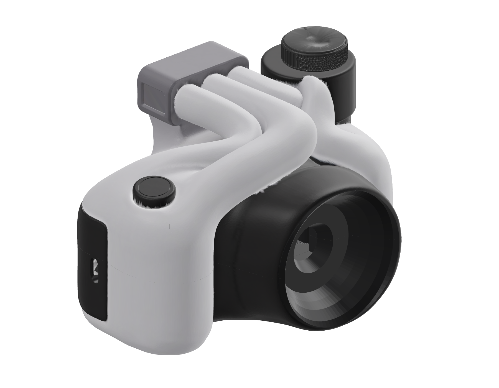
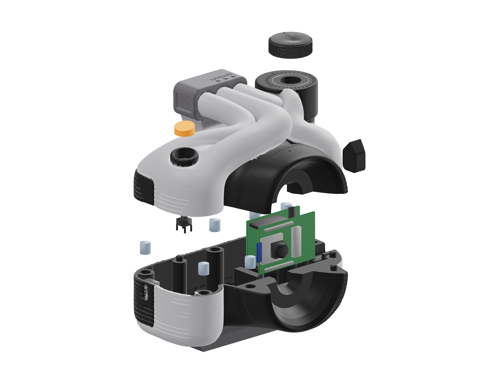
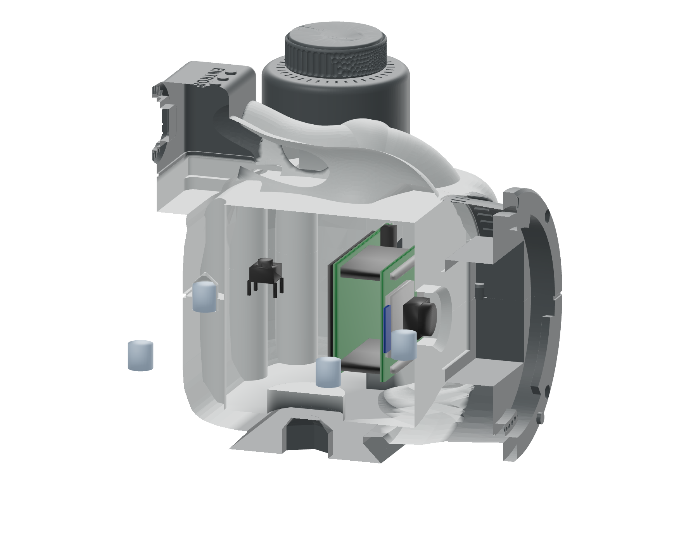

# Entropi · A3-print (delt skal)

A3-designet frå `arkiv/entropi-a3` bygd opp att som rein CAD: alle delane er B-rep-solidar (NURBS/analytiske flater i OCCT via build123d), ikkje mesh. Tripo-meshen er berre brukt som målestokk for forma. Kvar del ligg som STEP i `print/step/` og som tett tessellert STL i `print/stl/`. Modellen skal målast i to gråtonar, så renderane viser berre dei. Kroppen er delt vassrett gjennom linseaksen (z = 32) i eit botnskal og eit toppskal som blir haldne saman av seks magnetar og tre pinnar. Innsida er holt ut til ein jamn vegg på 2,6 mm, og elektronikken står i to sporstolpar. Framme på linseløpet sit ei Canon EF-bajonettfatning for fullformat: Ø66-flens, Ø54-hals, tre bajonettklør, kontaktblokk, utløysarpinne og raud-prikk-merke, og bak halsen eit spegelkammer med ein 36 × 24-sensorforsenking rundt linseopninga. Hjulet på toppen er bytt ut med A17-entropihjulet (`../../A17/entropihjul/`) på ein EC11-dreieknapp.







## Prent i denne rekkjefølgja

| Fil i `print/` | Delar | Tid | PLA |
| --- | --- | --- | --- |
| `A3-Entropi-botn-P1S.gcode.3mf` | Botnskal med skinne | 2 t 44 min | 77 g |
| `A3-Entropi-topp-P1S.gcode.3mf` | Toppskal | 3 t 54 min | 99 g |
| `A3-Entropi-smaadelar-P1S.gcode.3mf` | Utløysar, USB-lokk, hjulaksel | 12 min | 2 g |
| `A3-Entropi-hjul-A17-P1S.gcode.3mf` | A17-hjulet V1–V4, vel eitt | 39 min | 10 g |

Alle filene er slica med Bambu Studio 02.08.02.61:
- maskin «Bambu Lab P1S 0.4 nozzle», med P1S-startkoden (AMS-lasting, dysereins, 220 °C) og printar-ID C12
- prosess «0.20mm Standard @BBL X1C», som er standarden for P1S, med 3 Arachne-veggar og 15 % fyll
- filament «Bambu PLA Basic @BBL P1S 0.4 nozzle» på Textured PEI-plata
- trestøtte berre frå plata

`print/bambu/skal.json` har kontrollen for kvar fil.

Slik sender du ei fil: opne `.gcode.3mf` i Bambu Studio, trykk *Print plate*, vel P1S-en, knyt filament 1 til PLA-sporet og trykk *Send*. Du kan òg kopiere fila til microSD-kortet i skrivaren.

- **Botnskalet** står på skinna med delingsflata opp. Skinna er den flate botnen, og støtta står berre utanpå, under den runde botnkanten og linseløpet.
- **Toppskalet** står på delingsflata. Støtta står under det flate taket inne i skalet og kan takast ut gjennom den opne delingsflata. Magnetlommene, spora i kortstolpane, EC11-pipa, brytartrakta og USB-tunnelen har tak på 45°, så dei treng inga støtte.

## Forma som CAD

`verktoy/form_fraa_mesh.py` måler A3-forma frå Tripo-meshen (`arkiv/entropi-a3`) og skriv tala til `verktoy/form_maal.json`: 19 vassrette snitt gjennom kroppen (z 0,3–50), radiusprofilen til linseløpet og toppen av søkarblokka. `verktoy/royr_fraa_mesh.py` finn tubane som ryggar i eit høgdekart sett ovanfrå. `verktoy/cad_form.py` byggjer så forma som B-rep utan å røre meshen:

| Del | Solid |
| --- | --- |
| Kroppen med grepet | Ruled loft gjennom snitta, kvart snitt ein periodisk B-spline gjennom 140 punkt med fire faste ankerpunkt, og elleve innoverforskove snitt som rundar toppen av (r 8). Rillene i grepet og sporet langs delinga er skorne i dette loftet før samanføyinga |
| Linseløpet | Omdreiingsflate av den målte profilen (r 31,5 → 28,6 frå x 58 til 86) som går mjukt frå kragen i kroppen og ut i EF-flensen. Kroppen er skoren vekk innanfor r 28 rundt linseaksen frå x 66, så løpet ligg utanpå kroppen; kappa over z 50 er skoren innanfor r 31,3, like utanfor den største radiusen til løpet (31 ved x 66), så den runda toppen aldri møter løpet tangentielt, men står i ei skuggefuge på 0,3–2 mm rundt den øvre halvdelen av løpet, som ei linse som sit i ei opning i kroppen |
| EF-fatninga | Flens Ø66 (x 86,5–90) med 0,8 mm fas, hals Ø54 (x 84–90,5), tre bajonettklør r 23,8–27,3 over 42° (x 88–90), kontaktblokk nedst med åtte kontaktgroper, fire forsenkte skruehovud på r 30,5, utløysarpinne på r 30,3 og prikk på toppen. Bak halsen eit spegelkammer 44 × 30 mm (x 72–84) og ein sensorforsenking 36 × 24 mm. Utløysarknappen for objektivet er ein sylinder r 5 på sida av løpet |
| Tubane | Seks sveip (r 8,5, hjularmen 7,5) langs splinar med bøyeradius minst 10 mm, kontrollert mot tuberadiusen så sveipa ikkje skjer seg sjølve. Frå søkarblokka går éin tube til ein kule-knoke (r 9,5) over grepet der grepsryggen og gripframen tek av, éin over toppen og ned på linseløpet, og éin ut mot hjulsida og ned bak løpet med ein knoke der armen frå hjulbossen kjem inn. Kvar tube endar inne i ein knoke, blokka, løpet eller kroppen, så ingen endeflater er synlege |
| Søkarblokka | Boks 18 × 40,5 × 32 mm med fillet 2,5 mm, på ein plint (x 0–24, 1,5 mm breiare enn blokka, z 55–60) som tek overgangen til kroppen og som dei tre tubane går ut frå, så tubebotnane ligg inne i materiale heile vegen |
| Hjulbossen | Sylinder r 17,5 til z 80, fillet 2 mm, med ein kjegleforma krage r 20,5 → 17,5 (z 53–60) mot kroppen |
| Utløysarbossen | Sylinder r 9 til z 63,5, fillet 2,5 mm |

Holrommet er eit ruled loft av dei uskorne snitta forskove 2,6 mm inn (det minste av snitta ved z − 2,6, z og z + 2,6, så veggen held der flata hallar; golv z 5, tak z 55), lagt inn i kroppen som eit indre skal utan boolsk operasjon. Verneklossane som skal stå att i holrommet (golvet under brytarlomma, hylsa rundt USB-tunnelen med ein 45°-kjøl under, EC11-pipa) blir trekte frå kjernen før ho blir snudd; golvet under brytarlomma er ein sylinder r 8,8, for OCCT ignorerte ein boks på akkurat den staden stille. Søyler, stolpar, trakter og lommer er boksar, sylindrar og loft som blir trekte frå etterpå, éin om gongen. Tynne lukka skal (under 0,5 mm) som rillene etterlèt der dei går inn under løpet, blir kasta før holrommet blir lagt inn. Saumane mellom dei to gråtonane er spor skorne ved z 61 rundt søkarblokka (over plinten) og z 59 rundt hjulbossen og utløysarbossen, og panel-linja ved x 71,2 på linseløpet.

## Overflatedetaljar

Detaljane er skorne eller lagde til i `verktoy/cad_skal.py` som eitt solid per detalj (polare mønster av rektangel, ekstrudert tekst, band mellom omrisset og eit innoverforskove omriss), og måla ligg under `detalj` i konfigurasjonen. Alle spor er minst 0,5 mm breie og 0,4–0,5 mm djupe, så ei 0,4 mm dyse får dei med.

| Detalj | Kvar | Referanse |
| --- | --- | --- |
| Riller i grepet, 0,8 × 0,5 mm med 2,4 mm deling | Grepsida, z 8–50 | Nocs-kikkert, Hasselblad-grep |
| Arca-Swiss-skinne, 38 mm brei med 45° svalehale, og lomme for 1/4"-20-mutter med Ø7-hol | Under botnskalet, x 18–56 | Sirui TY-70 |
| Knurla ring med 60 spor | Linseløpet, x 73–77 | Leica Summicron |
| EF-bajonett med klør, kontaktar, skruar og pinne | Fronten, x 84–91 | Canon EF |
| Panel-linje rundt linsebasen, saum mellom gråtonane | x 71,2 | Canon Colani |
| Gradskala med 36 strek rundt hjulet | Toppen, r 12–15,5 | Sirui BH-60 |
| Gravert «ENTROPI» og tre små knappar | Toppen av søkarblokka | Hasselblad X2D |
| Knurla okularring som stikk 1,2 mm ut | Baksida | Leica |
| 0,4 mm fas på begge sider av delinga | Rundt heile kroppen | |
| To gråtonar: lys på kropp, tubar og linsering, mørk på søkarblokk, hjulboss, utløysar, linsefront med EF-fatninga, skinne og okular, skilde av spor i overflata | CMF, etter kursregelen om form | |

## Innkjøp

ESP32-CAM, ESP32-CAM-MB (micro-USB), microSD, 6 × 6 mm trykknapp, 12 magnetar Ø6 × 3 mm, 2 leidningar 26–30 AWG på om lag 15 cm, ein 1/4"-20-mutter til stativfestet og CA-lim.

EC11-dreieknapp med 20 mm D-aksel og M7-mutter er valfri. Har du han ikkje, limer du hjulakselen (smådelplata) i forsenkinga, og hjulet sit på han.

## Montering

1. Pinnane er prenta på botnskalet. Lim seks magnetar i lommene i botnskalet med same pol opp. Legg ein magnet på kvar av dei, og merk oversida. Lim dei merka magnetane i toppskalet med merket ned, slik at dei trekkjer mot kvarandre.
2. Lodd leidningane til GND (pinne 2) og IO13 (pinne 4) på 5V-rekkja på ESP32-CAM. Set kameraet på MB, set i SD-kortet, last opp firmware og test.
3. Senk stabelen rett ned i spora i dei to stolpane i botnskalet. Linsa går ned i halve linsesetet.
4. Før leidningane opp gjennom holet i brytartrakta i toppskalet. Lodd brytaren på to diagonale bein, og lim han i lomma med beina i full lengd.
5. EC11: før dreieknappen opp gjennom pipa i toppskalet til gjengene kjem ut i forsenkinga på toppen. Skru på M7-mutteren der; hjulet dekkjer han. Kort akselen til 5,5 mm over toppflata. Utan EC11 limer du hjulakselen i forsenkinga i staden.
6. Set toppskalet på. Pinnane styrer det, og magnetane held det.
7. Lim utløysaren på stempelet til brytaren (0,5 mm slag ned til botnen av brønnen), og trykk A17-hjulet på akselen.
8. Skyv USB-kabelen inn i tunnelen på hjulsida, eller set i USB-lokket.
9. Lim 1/4"-20-mutteren i sekskantlomma under skinna. Då kan kameraet stå på stativ.

Rettleiinga i IKEA-stil ligg i `montering/Entropi-A3-montering.pdf` (15 sider, 12 steg).

## Kontroll (`print/kontroll.json`)

Måla på elektronikken er nominelle, og fysisk passform er ikkje prøvd.

| Kontroll | Resultat |
| --- | --- |
| Delar | Botnskal 98.1 cm³ og toppskal 139.1 cm³. Alle fem delane er eitt gyldig B-rep-solid kvar (BRepCheck), og STL-ane er vasstette. |
| Kollisjon mellom elektronikk og skal | 0 mm³ for alle proxyar og for magnetane i lommene. Klaringa til stabelen er 0.2 mm i begge skala. |
| Monteringsbaner | 0 mm³ for: stabel ned i botnen, toppskal ned over stabelen, USB-plugg inn, EC11 opp i pipa, brytar ned i lomma |
| Veggar mot holrom | Stabelen 8.0 mm, brytarlomma 4.41, EC11-pipa 5.5, magnetlommene 1.5, USB-tunnelen 8.68 |
| Hjulet | Hjulbossen r 17,5 rundt (31.1; 103.9), toppen ved z 80. A17-hjulet er Ø24. |
| Forma mot Tripo-meshen | Kroppssnitta er målte frå meshen, så omrisset følgjer A3-forma; tubane, bossane og løpet er reine solidar lagde oppå |

## Kjende avgrensingar

- **Fysisk passform er ikkje prøvd.** Prøv stabelen i stolpane og skala mot kvarandre før du limer noko.
- **Utløysaren krev kode:** IO13 mot GND, med SD i 1-bit-modus og debounce. Hald blitzen (GPIO4) av. Legg inn OTA-oppdatering, for MB-knappane er innebygde.
- **USB-C-porten på grepet er berre form.**
- **EF-fatninga er form, ikkje funksjon.** Klørne og kontaktane har EF-måla (Ø54-hals, 44 mm flensavstand er ikkje halden), men det er ingen låsefjør; eit objektiv kan stå i halsen, ikkje låsast.
- Overgangen frå EC11-pipa til akselhòlet er 2 mm høg, så sidene står 56–60° og hjørna 72°; dei ligg over det opne sjaktet og kan få trestøtte om du vil, elles sig dei litt over Ø7,4-hòlet.
- Filene har ikkje miniatyrbilete.

## Regenerering

```bash
cd verktoy
npm install
pip install build123d
python3 form_fraa_mesh.py && python3 royr_fraa_mesh.py   # mål frå Tripo-meshen -> form_maal.json
python3 cad_skal.py       # B-rep-delar: print/step og print/stl
python3 kontroll_cad.py   # kontroll.json frå STL-ane og proxyane
python3 print_skal.py     # prentretning
bash bambu_skal.sh A3-Entropi-botn-P1S ../print/printretning/botn.stl
bash bambu_skal.sh A3-Entropi-topp-P1S ../print/printretning/topp.stl
bash bambu_skal.sh A3-Entropi-smaadelar-P1S ../print/printretning/utloysar.stl ../print/printretning/usb-lokk.stl ../print/printretning/hjulaksel.stl
python3 cmf_overfor.py && python3 vis.py
```

Mål og plasseringar ligg i `verktoy/delar_konfig.json` under `form`, `skal` og `detalj`. Luke-versjonen med stabelhaldar ligg i git-historikken (958babc).
