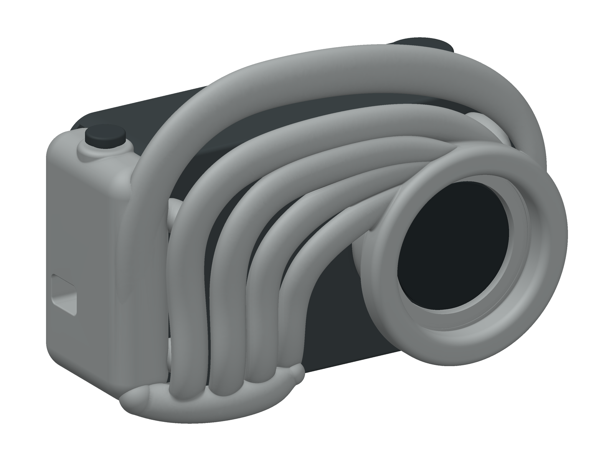

# A4 · Entropi

Alt samla arbeid med dette ribba kameradesignet høyrer til her. Siste redigerbare versjon er **CAD v05**.

## Finn rett fil

| Føremål | Plassering |
|---|---|
| Start, mål og monteringsrekkjefølgje | [Entropi-CAD-v05/README.md](Entropi-CAD-v05/README.md) |
| Native CAD-samanstilling | [Entropi-assembly-v05.step](Entropi-CAD-v05/Entropi-assembly-v05.step) |
| Farga 3D-visning | [Entropi-assembly-v05.glb](Entropi-CAD-v05/Entropi-assembly-v05.glb) |
| Separate STEP- og STL-delar | [Entropi-CAD-v05/parts](Entropi-CAD-v05/parts/) |
| Prentorienterte STL og to 3MF-plater | [Entropi-CAD-v05/print](Entropi-CAD-v05/print/) |
| CadQuery-kjelde og parameter | [Entropi-CAD-v05/cad](Entropi-CAD-v05/cad/) |
| Sju faktiske CAD-rendringar | [Entropi-CAD-v05/preview](Entropi-CAD-v05/preview/) |
| Kritikk og grunngjeving | [design_review.md](Entropi-CAD-v05/cad/design_review.md) |
| Kontrollresultat og filkontrollsummar | [release_summary.json](Entropi-CAD-v05/release_summary.json) |
| Samla nedlastingspakke | [Entropi-CAD-v05.zip](leveransar/Entropi-CAD-v05.zip) |
| Prentklar A3-versjon for Bambu P1S (lim og magnetar), med IKEA-rettleiing | [Entropi-A3-print](Entropi-A3-print/README.md) |
| Markeringar, vald form og oppgåvedokument | [referansar](referansar/) |
| Tidlegare material- og fargestudiar | [rendringar/materialstudiar](rendringar/materialstudiar/) |
| A1: byggjerettleiing R03, 29 sider og P1S-instruks | [A1 CAD-assembly](arkiv/tripo-a1/cad-assembly/README.md) |
| Eldre CAD og heile Tripo-historikken | [arkiv](arkiv/) |
| Opphav og flytting av filer | [organisering.json](organisering.json) |

## Kva som er endra i v05

Ribbeføtene går inn i ein synleg botnboge. Dei tre flate stubbene bak føtene er fjerna. Knappefestet, overgangen til frontringen og portleppa er avrunda i native CAD. USB-brønnen er utvida, og skruefesta for I/O-plata er flytta ut av den nominelle pluggbanen.

## Kontrollstatus

18 delar i samanstillinga og 20 prentdelar, med to kalibreringsdelar. Native solid, lukka STL/GLB, 153 innbyrdes delpar, fem uttaksbaner, 27 skruevolum, fem knappestillingar og eit kontinuerleg nominelt USB-innføringsvolum er kontrollerte. Omfanget for kvar kontroll står i rapporten; fire uttaksbaner er diskret prøvde, medan blenda også har ein kontinuerleg volumkontroll.

Fysisk passform, faktisk elektronikk, fjørlevetid, optikk, lading og biletoverføring er ikkje verifiserte. Prent dei to kalibreringsdelane før hovuddelane, mål maskinvara og kontroller støtte og verktøybaner i sliceren.

## Struktur vidare

Nye versjonar av dette designet skal leggjast under `A4`. Behald versjonsnummer og tilhøyrande kjelde, kontrollrapportar, referansar og rendringar samla. Den gamle `A1`-leveransen ligg no i `arkiv/tripo-a1`, den organiserte `A3`-leveransen ligg i `arkiv/entropi-a3`, og råinnhaldet frå Entropi-greina er samla i `arkiv/entropi-tripo`.

