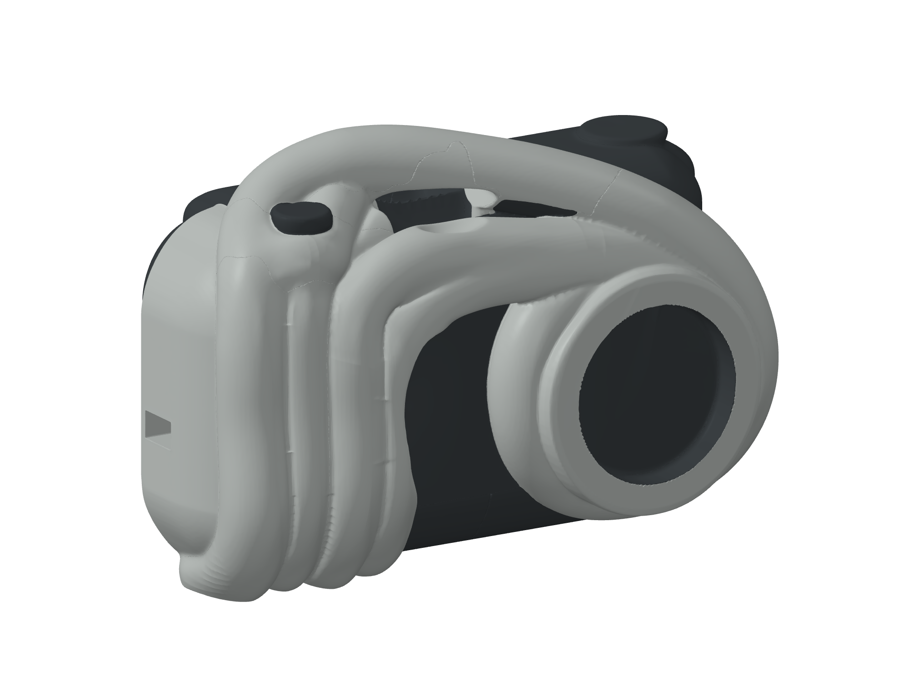

# Entropi - A1

[Opne ny mekanisk assembly R01](cad-assembly/README.md)

Ny CAD-versjon med 11 mekaniske produktdelar, separate printmodellar og ei byggjerettleiing R03 på 29 sider med 23 byggjesteg, frå Arduino IDE og ESP32-CAM til utløysar og mekanisk montering. Begge printplatene er digitalt slicer-verifiserte. Faktiske ESP32-CAM/MB-mål, brytar, straum/USB og fysisk prøvepass står att før frigjeving.

[Byggjerettleiing R03](cad-assembly/review/A1-Byggjerettleiing-R03.pdf) | [Alle sidene som bilete](cad-assembly/review/Byggjesteg-R03-bilete.md) | [P1S-instruks](cad-assembly/PRINT-P1S.md) | [ESP32-testprogram](cad-assembly/firmware/README.md) | [Eksplodert isometrisk teikning](cad-assembly/review/A1-exploded-lines.png) | [CAD- og printfiler](cad-assembly/)

## Opphavleg Tripo-formgrunnlag

[Opne utskriftsmodellen: Entropi-140mm.3mf](print/Entropi-140mm.3mf)

Forma kjem frå det valde referansebiletet gjennom Tripo Ultra, Smart Segment og Quick Cap. Printmodellen bevarer den detaljerte meshen som eitt samla objekt med 11 volum. Breidda på **140 mm er ein føresett modellstorleik**.

Generisk slicing er verifisert med PLA, 0,4 mm dyse, 0,20 mm lag, 3 veggar, 15 % gyroid og automatisk støtte overalt, også under bruer. Kontrollen stadfestar modell- og støtteekstrudering utan åtvaringar.

Opne 3MF i Bambu Studio, vel den faktiske **Bambu Lab P1S- og PLA-profilen**, og kontroller retning og støtte før utskrift. Fysisk utskrift og passform er ikkje testa.

Sjå [LES-MEG.txt](LES-MEG.txt), [slicingkontrollen](verification/slicer-checks.json) og [filmanifestet](manifest.json) for detaljar.

## Opphavleg formmodell: print og monteringskontroll

**Det opphavlege formgrunnlaget nedanfor er ein formmodell.** Den nye mekaniske assemblyen og byggjeguiden ligg i `cad-assembly/`. Kamerafeste, komponentmål, kabelvegar og mekaniske klaringar er ikkje verifiserte.

[Isometrisk rettleiing med printsteg og monteringsstatus](review/print-og-montering/A1-Print-og-Monteringskontroll.pdf)

[Isometrisk vising](review/print-og-montering/A1-isometrisk.png) | [Printretning](review/print-og-montering/A1-printretning.png) | [Bakside](review/print-og-montering/A1-bakside-isometrisk.png)
