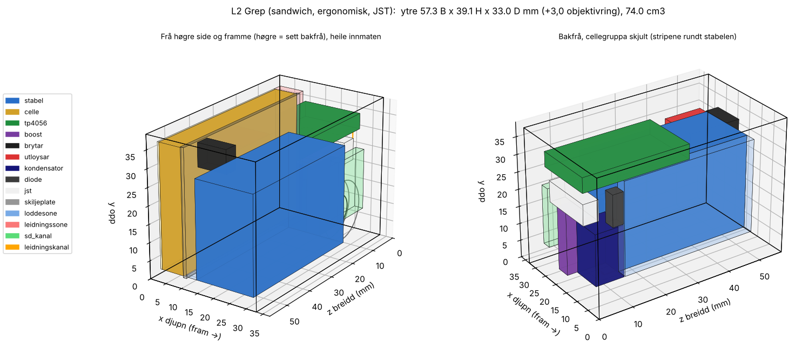

# A5 – kamera med heile «Arduinoen» og oppladbart batteri inne

Nytt design. Inne sit ESP32-CAM på ESP32-CAM-MB, ein 1S LiPo med USB-C-lading, ein 5 V-boost, ein av/på-brytar og ein utløysar. Kjeda følgjer `skisse-til-cad`: innmat og pakking → konseptbilete i Tripo → val → 3D-master → CAD rundt innmaten → print → IKEA-rettleiing.

Status: innmat og pakking er ferdige, og konseptbileta ligg til val. Ingenting er printa eller prøvemontert.

## Innmat

Researchen med kjelder ligg i [`innmat/straum.json`](innmat/straum.json) og [`innmat/esp32-integrasjon.json`](innmat/esp32-integrasjon.json). Tala er frå datablad, og forhandlarmål er merkte som usikre.

| Del | Val | Mål (mm) |
| --- | --- | --- |
| Kamera | ESP32-CAM (AI-Thinker, OV2640) på ESP32-CAM-MB | stabel 40,5 × 27–29 × 18–22 |
| Batteri | EEMB LP603448-PCM-LD, 1050 mAh, JST-PH 2,0 (eller 503450/603450 innanfor 52 × 34,5 × 6,3) | maks 50,0 × 34,5 × 6,3 |
| Lading | TP4056-modul med USB-C og DW01A/FS8205A; byt R3 til 2,4 kΩ (0,5 A) | planlagt 29 × 17,3 × 4,3 |
| Boost | Pololu U1V11F5, fast 5 V, med SHDN | 12 × 15 × 3 |
| Av/på | SS-12D00 på SHDN (lukka = AV) | 8,5 × 3,5 × 7,2 |
| Utløysar | taktil brytar mellom GPIO13 og GND | 6 × 6 eller 12 × 12 |
| Vern | 1N5817 frå boost til 5 V, 470 µF/10 V ved 5 V-padden | Ø8 × 11,5 |

Driftstid er rekna til om lag 3 timar ved 220 mA (2,5–3,5 t), og ladetid til om lag 2,5–3,5 timar ved 0,5 A. Begge er overslag, ikkje målte.

### Koplingstabell

| # | Frå | Til | Merknad |
| --- | --- | --- | --- |
| 1 | LiPo + / − (JST-PH) | TP4056 B+ / B− | mål polariteten før du koplar, JST-PH er ikkje standardisert |
| 2 | TP4056 OUT+ | U1V11F5 VIN | lasta skal på OUT, aldri på B− |
| 3 | TP4056 OUT− | U1V11F5 GND | systemjord |
| 4 | SS-12D00 felles / ytterpinne | U1V11F5 SHDN / GND | lukka brytar = AV; brytaren ber ikkje batteristraum |
| 5 | U1V11F5 VOUT | 1N5817 anode | plassen er halden av; diode eller lus etter måling |
| 6 | 1N5817 katode (ring) | MB underside, 5 V-padden (pad 1) | = CAM 5V (P2-8) |
| 7 | U1V11F5 GND | MB underside, GND-padden (pad 2) | ekte jord, ikkje «GND» ved U0T |
| 8 | 470 µF + / − | 5 V-padden / GND-padden | tett ved padane |
| 9 | Utløysar (diagonale bein) | IO13-padden (pad 4) / GND | SD i 1-bit-modus; `INPUT_PULLUP` etter `SD_MMC.begin` |
| 10 | Valfritt: IO12-padden (pad 3) | 1 kΩ → LED → GND | ingen opptrekk på GPIO12 (strappinne) |

Padane sit i 5 V-rekkja på undersida av MB, 4,58 / 7,12 / 9,66 / 12,20 mm frå SD-enden til CAM-en (låg tillit). Rekkjene er spegla sett nedanfrå, så finn rekkja med multimeter først.

**Reglar:** éi 5 V-kjelde om gongen (brytaren AV når micro-USB står i). Ikkje lad utan tilsyn med kameraet lukka. Hald cella og boostspolen unna antennesona til CAM-en.

## Pakking

[`innmat/pakking.py`](innmat/pakking.py) prøver alle orienteringar og plasseringar med klaringar på 0,3 mm rundt korta, +10 % celletjukn, 0,5 mm skumpute, 2,0 mm veggar og leidningskanalar ruta med lengdegrenser. Alle fem layoutane har null overlapp. Resultatet ligg i [`innmat/pakking.json`](innmat/pakking.json) og `innmat/layout_*.png`.

Tilrådd er **L2 «Grep»**: 57,3 B × 39,1 H × 33,0 D mm (36,0 med objektivringen), 74 cm³ og ca. 60–68 g. Cella ligg flatt bak MB med ei heil skiljeplate imellom, TP4056 ligg flatt i toppstripa, og boost, kondensator og diode sit i dødromma ved linsa. 74 cm³ er den nedre grensa for denne familien. Mindre blir det berre utan MB inne eller med ei anna celle.

Huset er eit frontskal i fem sider, eit skyvelokk bak (1,6 mm i spor) og ei innmatsramme med skiljeplate som klikkar inn. Det er ingen skruer.

### Overflate med funksjon

Pakkinga gir 22 overflatedetaljar med posisjon og mål, sjå `overflate` i `pakking.json`. Dei viktigaste sett framanfrå:

- objektivring Ø16 × 3 til høgre for midten, 41 % av høgda; blitsvindauge oppe til venstre
- grepsone framme til venstre med riller; utløysar med krage og forsenka av/på-brytar på toppen over grepet
- USB-C og microSD på høgre side, programmeringsport med propp på venstre side
- ladelys som lysleiarar på toppen, luftespalter i botnen ved boost og ESP32 og ved programmeringsporten
- trykkavlastning og tommelkvile i baklokket, skuggefuge rundt bakkanten, stroppfeste i hjørnet og graverte merke ved kvar port

### Må målast før CAD

TP4056-kortet (mål, USB-C-overheng og LED-plassering), høgda til micro-USB og knappane på MB, stabelhøgd og linseposisjon, og leidningslengda på cella (100 mm mot ein kanal på 32 mm).

## Konsept

[`konsept/blokk.py`](konsept/blokk.py) lagar ei proporsjonsblokk med dei faktiske måla og detaljplasseringa. Ho er brukt som `image[1]` i Tripo, slik at konsepta held seg innanfor pakkinga. Jobbane ligg i [`konsept/jobbar.json`](konsept/jobbar.json), og resultata med task-ID, kreditt og sjekksummar i `konsept/tripo/*/task.json`.
