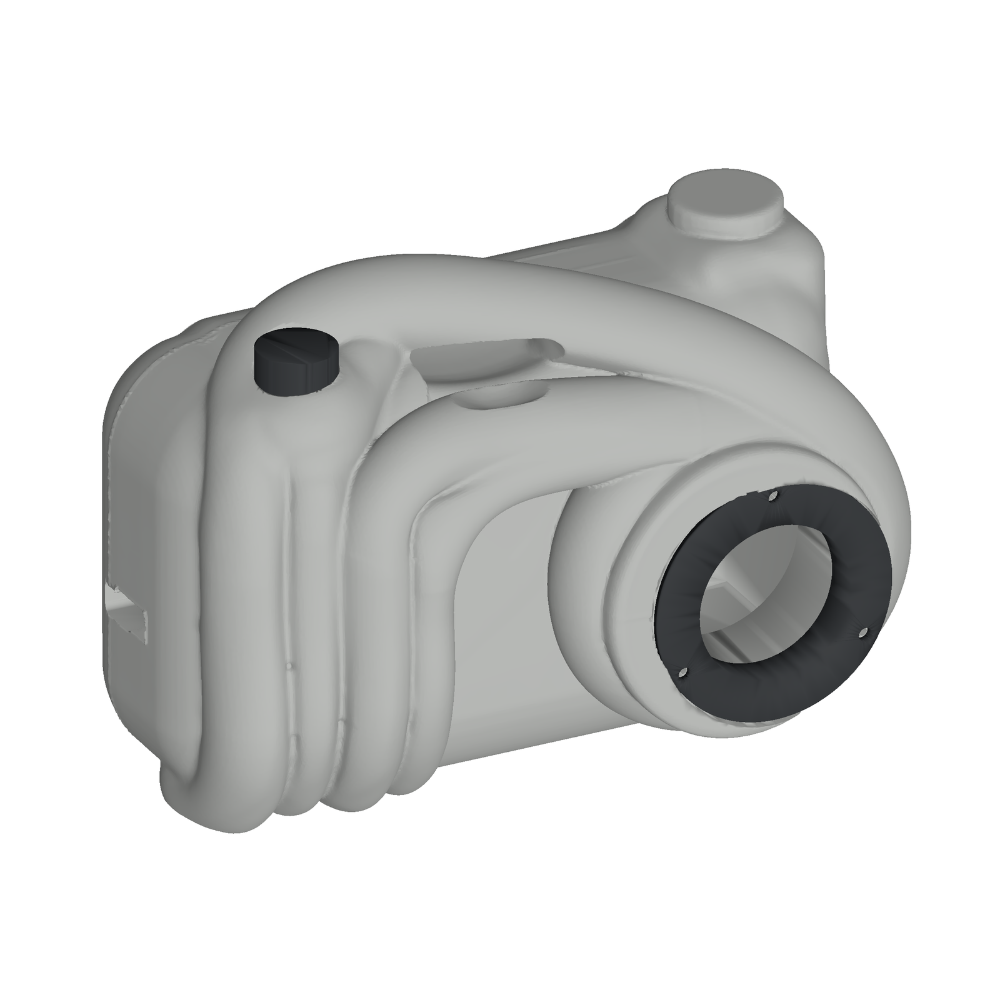

# Kamera med boge

Den valde forma (`reference/sketch.png`) ført gjennom Tripo, mekanisk CAD R01, P1S-slicing og monteringsrettleiing M05. Førebels breidd er 145 mm. Ytterforma er mesh; STEP dekkjer P03, P04, P05 og T01. Faktisk elektronikk og maskinvare er ikkje målte, og ingenting er printa fysisk enno.



## Status

| Steg | Status |
|---|---|
| Tripo-master og segmentering frå det valde biletet | Ferdig (80 kreditt, `verification/tripo-receipt.json`) |
| Mekanisk CAD R01: fem delar, passningsprøve T01, 13 nominelle skruar og mutrar | Ferdig, digitalt kontrollert (`verification/mechanics.json`) |
| Veggtjukkleik på det organiske skalet | Kontrollert og dokumentert (`verification/wall-thickness.json`) |
| Slicing for Bambu Lab P1S, tre plater med G-kode | Ferdig (`print/bambu/`, `verification/slicing-p1s.json`) |
| Rendringar av faktisk R01-geometri | Ferdig (`review/`) |
| Monteringsrettleiing M05, 16 sider med printside, feilsøking og formlinjer frå målte buffer | Ferdig (`manual/`) |
| Fysisk utskrift, passform, fjørretur, maskinvare | Står att |

## Prent på P1S

Dei tre filene i `print/bambu/*.gcode.3mf` er slica med Bambu Studio 02.08.02.61 og dei offisielle profilane for Bambu Lab P1S 0,4 mm, Textured PEI-plate og Bambu PLA Basic: 0,20 mm Standard, 3 veggar (Arachne), 15 % gyroid, trestøtte. Framhuset har støtte også på modellen, fordi holromstaket og linseholet berre kan støttast innanfrå. Dei andre platene har støtte berre frå plata. Filene har P1S-startkode, AMS-lasting og printar-ID C12, men inga miniatyrbilete.

| Plate | Delar | Tid | PLA |
|---|---|---|---|
| `Plate-00-prove-P1S.gcode.3mf` | T01 passningsprøve + P04 knapp | 27 min | 9 g |
| `Plate-01-framhus-P1S.gcode.3mf` | P01 framhus, oppreist | 7 t 12 min | 200 g |
| `Plate-02-deksel-og-smadelar-P1S.gcode.3mf` | P02 bakdeksel, P03 linseinnsats, P05 prøvefjør | 1 t 51 min | 49 g |

1. Opne `Plate-00-prove-P1S.gcode.3mf` i Bambu Studio (Fil → Opne), trykk *Print plate* og vel P1S-en. Knyt filament 1 til PLA-spolen. Utan nettverk: kopier fila til microSD-kortet og start henne frå skjermen.
2. Prøv T01 og P04: knappen skal gli i Ø16,4-holet, M3-mutteren skal passe i AF5,9-lomma, og M3/M2,5-skruane skal gå i pilotane. Passar det ikkje, juster `cad/parameters.json` og bygg på nytt før framhuset.
3. Prent framhuset. Trekk støtta ut gjennom bakopninga, ut av linseholet, knappeholet og under bogen. Prent deretter deksel og smådelar.
4. Følg `manual/Kamera-boge-M05.pdf`.

Tidene er sliceranslag. `print/bambu/profil/` har dei faktiske profilane, `print/bambu/*.json` tid, vekt og G-kodekontrollen per plate. Platefilene utan G-kode (`print/Plate-*.3mf`) har same plassering, for å endre innstillingar sjølv.

## Filer

| Mappe eller fil | Innhald |
|---|---|
| `print/bambu/` | Tre slica P1S-plater med G-kode, profilane og slicerapportane |
| `print/Plate-00-prove.3mf`, `Plate-01-framhus.3mf`, `Plate-02-deksel-og-smadelar.3mf` | Same plater som geometri, utan G-kode |
| `print/*.stl` | T01, P03, P04 og P05 i printorientering |
| `manual/Kamera-boge-M05.pdf` | 16 A4-sider med tekniske vektorfigurar frå uendra CAD: silhuettar og eksakte kantar frå VTK, formlinjer på dei organiske delane målte frå djupne- og normalbuffer, printside og feilsøking |
| `manual/pages/` | Dei 16 sidene som PNG |
| `manual/Kamera-boge-M05-kjelder.zip` | Kjeldekode, SVG, scenar og kontrollrapportar for manualen; M03-kjeldene ligg ved som historikk |
| `review/` | Åtte rendringar av R01: hero, front, bak, grepside, linseside, topp, bak-3/4 og eksplodert |
| `cad/assembled.3mf` | Full geometri for P01 til P05 i CAD-koordinatar, mm |
| `cad/*.step` | Analytisk mekanikk (P03, P04, P05) og passningsprøva T01 |
| `cad/hardware/` | Nominelle illustrasjonsmodellar av skruar og mutrar, skal ikkje printast |
| `verification/` | Digitale kontrollar: geometri, rørsle, veggtjukkleik, slicing, eksport, manual og rendringar |
| `reference/sketch.png` | Det valde referansebiletet |

To store filer er delte i tapsfrie delar under `payloads/`: `cad/assembled.3mf` og `print/Plate-01-framhus.3mf`. `Open-Print.ps1` set dei saman på Windows og opnar ei plate i Bambu Studio; `python source/verify_package.py` kontrollerer alle filhashar og set ikkje saman noko. `large-files.json` har rekkjefølgje, storleik og SHA256.

```powershell
powershell -File .\Open-Print.ps1 -Plate Prove   # opnar den slica prøveplata
powershell -File .\Open-Print.ps1 -Plate Front   # opnar det slica framhuset
```

## Kontroll

R01-verifikasjonen finn lukka mesh, ingen målbar kollisjon mellom delane og prøvde, diskrete monteringsstillingar for deksel, linseinnsats og knapp (`verification/mechanics.json`). Veggtjukkleiken er målt langs normalen: framhuset er tjukt (median 14 mm), og det som er tynnare enn 1,2 mm er fjørkantar der det organiske skalet møter eit snitt. Bakdekselet har ein knivskarp kant heile vegen rundt, fordi den runda baksida blir kutta av seamplanet. Det er dokumentert, ikkje retta. Slicinga er kontrollert i G-koden: startkode, temperatur, støtte under holromstaket og i hola, bruer og støttevolum (`verification/slicing-p1s.json`).

Ikkje verifisert: fysisk utskrift, støttefjerning, passform, fjørretur og slitestyrke, faktisk elektronikk og kontaktar. Maskinvara er nominelt seks M3 × 12, fire M3-mutrar og tre M2,5 × 8. Stram varsamt i printa pilotar.

Ingen ny Tripo-jobb trengst for å byggje pakken på nytt. CAD-kjelda for R01 ligg ikkje i repoet; geometrien er bevart i `cad/assembled.3mf`.
